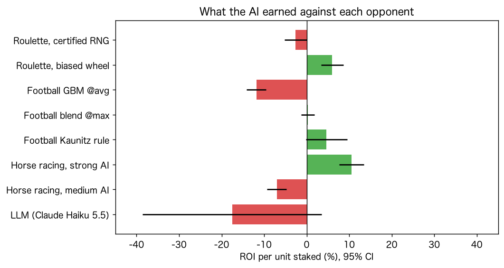

# bet-with-ai — AIは賭けに勝てるか

「AIは不確実な勝負にどこまで勝てるか」を、プログラムで検証するリポジトリです。数学（乱数）・人・胴元・市場という相手ごとにAIを実際に戦わせ、勝ち負け、勝率、期待値を測り、勝因と敗因を分解しました。結果と考察は [report.md](report.md) にまとめています。

[English summary](#english-summary)

> このリポジトリは、賭け事や投資・トレードを勧めるものでも、否定するものでもありません。数値は仕組みを確かめるための検証結果で、賭けや投資の助言ではありません。

## 解説記事

- 理論編・前編（X）：[AIは賭けに勝てるか——「誰が相手か」で読み解く、勝敗の構造](https://x.com/cv_usk/status/2111590372749287711)
- 理論編・後編（note）：[AIは賭けに勝てるか——「何が必要か」で読み解く、勝つための条件](https://note.com/cvusk/n/n0412f8bd6649)
- 検証編（Qiita）：[AIは賭けに勝てるか【検証編】——6万試合の実データ、ポーカーAI、本物のLLMで勝因と敗因を分解する](https://qiita.com/cvusk/items/989229754e1da002e93e)

## 主な結果

- **数学が相手なら、勝因は相手の欠陥だけ。** 同じ学習AIが、認証された乱数には理論どおり負け（ROI −2.6%）、偏ったホイールや弱い疑似乱数には勝った。
- **人が相手なら、利益は相手の癖で決まる。** CFRで学習した均衡AIは慎重な相手からほぼ稼げず、癖を突くAIは稼いだ。利益の大半は相手の2〜4個の判断ミスから来ていた。
- **欧州サッカー約6万試合の実データで、機械学習モデルは市場に勝てなかった。** モデルが見込んだ期待値 +22% に対し、実際のROIは −12%（約2万回）。プラスになったのは、予測を使わない価格比較のルールだけだった（+4.7%、有意性は境界）。
- **勝つ客は、実力を証明する前に制限される。** 優位の証明に約1万回かかる客が、模擬では数十回で制限された。
- **競馬（控除率20%）では、市場に勝つのに必要な情報優位 0.223 ナッツに、どのAIも届かなかった。** 成長率の恒等式は機械精度で成り立った。
- **株式では、機械学習のシグナルはコストに負け、2000年以降は消えた。**
- **本物のLLM（Claude Haiku 5.5）の予測は、市場より不正確だった。** 同じ質問を2回すると、80%の試合で答えが変わった。



## 研究の一覧

| 研究 | 相手 | データ | コード | 結果 |
|---|---|---|---|---|
| 1 | 数学：ルーレットとスロット | 模擬 | [s1_chance.py](betai/s1_chance.py) | [s1_chance.md](outputs/s1_chance.md) |
| 2 | 人：ポーカー（CFR）と麻雀 | 厳密計算・模擬 | [s2_skill.py](betai/s2_skill.py) | [s2_skill.md](outputs/s2_skill.md) |
| 3 | 胴元と市場：欧州サッカー | 実データ（football-data.co.uk） | [s3_sports.py](betai/s3_sports.py) | [s3_sports.md](outputs/s3_sports.md) |
| 4 | 胴元：勝つ客の口座制限 | 模擬（研究3の値を使用） | [s4_house_limits.py](betai/s4_house_limits.py) | [s4_house_limits.md](outputs/s4_house_limits.md) |
| 5 | 市場：パリミュチュエルの競馬 | 模擬 | [s5_parimutuel.py](betai/s5_parimutuel.py) | [s5_parimutuel.md](outputs/s5_parimutuel.md) |
| 6 | 市場：米国株100年 | 実データ（Kenneth R. French Data Library） | [s6_trading.py](betai/s6_trading.py) | [s6_trading.md](outputs/s6_trading.md) |
| 7 | 本物のLLMに賭けさせる | 実データ＋Anthropic API | [s7_llm.py](betai/s7_llm.py) | [s7_llm.md](outputs/s7_llm.md) |
| 8 | まとめ | 研究1〜7の出力 | [s8_synthesis.py](betai/s8_synthesis.py) | [s8_synthesis.md](outputs/s8_synthesis.md) |

共通の処理は [betai/common.py](betai/common.py)（統計と出力）と [betai/data.py](betai/data.py)（データの取得とオッズのマージン除去）にあります。テストは [tests/](tests/) にあります。

## 実行方法

必要なもの：[uv](https://docs.astral.sh/uv/)（Python 3.12以上。`.python-version` は 3.13）

```bash
git clone https://github.com/shibuiwilliam/bet-with-ai.git
cd bet-with-ai
uv sync           # 依存関係を uv.lock の版で入れる
./run_all.sh      # 全研究を実行
./run_all.sh s3   # 一部だけ実行
```

- 初回は公開データ（約30MB）をダウンロードするので数分かかります。2回目以降は約1分です。
- 結果は `outputs/` に書き出されます（`*.md` は読みやすい表、`*.json` は数値、`figures/` は図）。このリポジトリに含まれている `outputs/` と同じものが再現されます。

## データ

| データ | 提供元 | 使った研究 |
|---|---|---|
| 欧州18リーグの試合結果・シュート数・各社のオッズ（2017/18〜2026/27） | [football-data.co.uk](https://www.football-data.co.uk/) | 3, 4, 7 |
| 米国株の日次の市場超過リターン・短期金利（1926〜2026年）、49業種ポートフォリオ | [Kenneth R. French Data Library](https://mba.tuck.dartmouth.edu/pages/faculty/ken.french/data_library.html) | 6 |

- 第三者のデータは、このリポジトリには含めていません。`betai/data.py` が実行時に提供元からダウンロードし、`data/` に保存します。利用条件は各提供元のサイトで確認してください。
- 公開した結果に使ったファイルのURL・SHA-256・取得日時は [data/MANIFEST.json](data/MANIFEST.json) にあります。
- 提供元のデータは随時更新されます。読み込み時に公開した結果の最終日（サッカー 2026-10-14、株式 2026-08-31）で切るので、過去の行が修正されない限り同じ結果になります。ダウンロードしたファイルが記録と異なるときは注意を表示します。

## LLMの実験（研究7）について

- Claude Haiku 5.5（`claude-haiku-5-5`）に、プレミアリーグ460試合の結果の記憶、予測、オッズを見たうえでの予測を尋ねました。API呼び出しは計161回（入力約12万、出力約7万トークン）でした。
- モデルの回答は [data/llm_cache/](data/llm_cache/) に保存してあり、`./run_all.sh` はAPIを呼ばずに同じ回答を再採点します。APIキーは不要です。
- モデルに問い合わせ直すには、`data/llm_cache/` を消し、`ANTHROPIC_API_KEY` を環境変数か、リポジトリ直下の `.env` に設定して実行します（`.env` は `.gitignore` 済み）。LLMの出力は同じ質問でも変わるので、結果は少し変わります。

## 再現性

- 乱数の種は全て固定しています。
- 依存ライブラリの版は `uv.lock` で固定しています。
- 同じ環境で全研究を2回実行し、全ての Markdown と JSON がバイト単位で一致することを確認しました。

## 開発

`uv sync` で、開発用のツール（ruff、isort、pytest）も入ります。設定は [pyproject.toml](pyproject.toml) にあります。

```bash
uv run isort betai tests          # import を並べ替える
uv run ruff format betai tests    # コードを整形する
uv run ruff check betai tests     # Lint
uv run pytest                     # 全テスト（約1分）
uv run pytest -m "not slow"       # 単体テストだけ（数秒）
```

テストは2種類です。

- **単体テスト：** 小さな合成データで、計算の正しさと時点の管理を確かめます。例：統計量と必要標本数、オッズのマージン除去、特徴量が当日以降の結果を使わないこと、株式のモデルが将来のデータで学習しないこと、成長率の恒等式、CFRの収束とゲームの値、シャープレイ値の合計、LLMの回答キャッシュ。ネットワークには接続しません。
- **回帰テスト（`slow`）：** 各研究を一時ディレクトリで再実行し、Markdown と JSON が `outputs/` と一字一句一致することを確かめます。ダウンロードしたデータが要る研究（3・4・6・7）は、`data/` にデータがなければスキップします。

## 限界

模擬の研究（1・2・4・5）の数値は仮定に依存します。サッカーの「最高値」のオッズで実際に約定できたとは限りません。LLMの実験は1モデル・460試合です。詳しくは [report.md の「限界」](report.md#5-限界) を参照してください。

## ライセンス

コードとこのリポジトリの文書は [Apache License 2.0](LICENSE) です。ダウンロードするデータの権利は各提供元にあります。

---

## English summary

**Can AI win a bet?** This repository tests that question with code. An AI is pitted against each kind of opponent (random numbers, people, the house, the market), and its wins, losses, hit rate and expected value are measured and decomposed into what made it win or lose. The full write-up (in Japanese) is [report.md](report.md).

- **Random numbers:** the same learning agent loses exactly the house edge against a certified RNG (ROI −2.6%). It wins only against a biased wheel or a weak PRNG, so the win comes from the flaw, not the AI.
- **People (poker):** a CFR equilibrium bot barely profits from a tight opponent. An exploiting bot profits, and most of the profit comes from two to four of the opponent's mistakes (Shapley attribution).
- **Football, about 60,000 real matches:** machine-learning models were less accurate than the closing market. The models expected +22% on their value bets; the realised ROI was −12% over about 20,000 bets. Only a model-free line-shopping rule was positive (+4.7%, borderline significance), and its best prices suffer adverse selection.
- **The house:** a simulated bookmaker restricts winning accounts after a few dozen bets, long before the bettor could prove an edge (about 10,000 bets).
- **Pari-mutuel racing at a 20% takeout:** no AI came close to the 0.223-nat information edge needed to beat the market. The growth identity W = ln(1−t) + D(p‖r) − D(p‖q) holds to machine precision.
- **US stocks, 100 years:** machine-learning industry signals lose to trading costs, and the edge disappeared after 2000.
- **A real LLM (Claude Haiku 5.5):** its forecasts were less accurate than the market, and asking the same question twice changed the answer for 80% of the matches.

Run it with `uv sync && ./run_all.sh`. Third-party data is downloaded at run time, not redistributed. The LLM's answers are cached in `data/llm_cache/`, so no API key is needed to reproduce the results. This repository does not recommend or discourage gambling or trading, and nothing in it is financial advice. Code is licensed under Apache-2.0.
