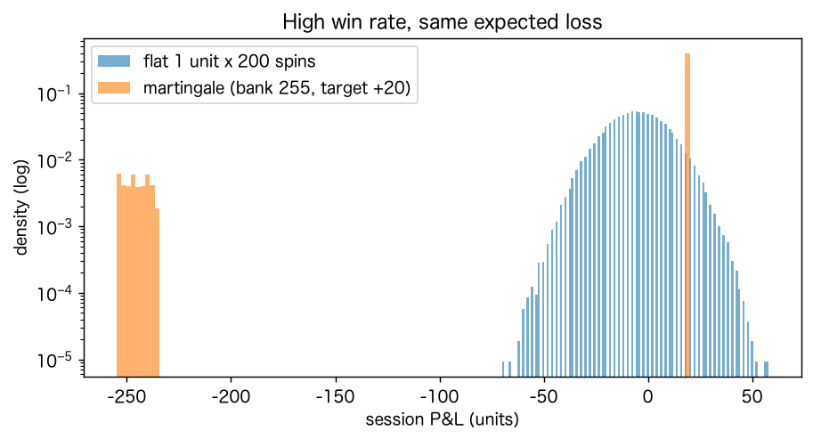

# 研究1　相手が「数学」：ルーレットとスロット

目的：認証された乱数に対して、学習するAIが優位を得られるかを確かめる。同じAIを、欠陥のある乱数源（偏ったホイール、弱い疑似乱数）にも当て、勝ちの原因がAIの賢さか、相手の欠陥かを切り分ける。

設定：ヨーロピアン・ルーレット（37ポケット）の1点賭け（当たれば36倍、期待値 -2.70%）。各乱数源で 200,000 回転。AIは直前k回の出目から次の出目を数え上げで学習し、最も多い出目に賭ける（k=0：頻度モデル、k=2：2次マルコフモデル）。「強制」は毎回賭け、「選択的」は事後確率で損益分岐（1/36）を99%以上の確度で超えるときだけ賭ける。

## 1. 学習するAIは乱数に勝てるか

| 乱数源 | 文脈 | 賭け方 | 賭けた回数 | 的中率 | ROI | ROI 95%CI | 後半のROI |
|---|---|---|---|---|---|---|---|
| certified RNG | k=0 | forced | 200,000 | 2.73% | -1.68% | [-4.20%, +1.02%] | +0.44% |
| certified RNG | k=0 | selective | 316 | 2.22% | -20.25% | [-66.11%, +48.10%] | -8.86% |
| certified RNG | k=2 | forced | 199,998 | 2.71% | -2.62% | [-5.19%, +0.01%] | -3.12% |
| certified RNG | k=2 | selective | 16,872 | 2.52% | -9.32% | [-18.07%, -0.78%] | -10.81% |
| biased wheel (3 pockets +10%) | k=0 | forced | 200,000 | 2.94% | +5.98% | [+3.45%, +8.68%] | +5.91% |
| biased wheel (3 pockets +10%) | k=0 | selective | 191,689 | 2.95% | +6.11% | [+3.42%, +8.78%] | +5.92% |
| biased wheel (3 pockets +10%) | k=2 | forced | 199,998 | 2.67% | -3.90% | [-6.42%, -1.38%] | -6.69% |
| biased wheel (3 pockets +10%) | k=2 | selective | 17,772 | 2.67% | -3.98% | [-12.90%, +4.32%] | -1.96% |
| weak PRNG (12-bit LCG) | k=0 | forced | 200,000 | 1.68% | -39.43% | [-41.50%, -37.41%] | -39.09% |
| weak PRNG (12-bit LCG) | k=0 | selective | 0 | — | — | — | — |
| weak PRNG (12-bit LCG) | k=2 | forced | 199,998 | 65.69% | +2264.76% | [+2257.27%, +2272.62%] | +2293.48% |
| weak PRNG (12-bit LCG) | k=2 | selective | 193,696 | 66.64% | +2299.02% | [+2291.42%, +2306.53%] | +2294.45% |

### 過去の出目が次の出目について持つ情報量（相互情報量）

相互情報量はプラグイン推定（単位ナッツ）から、次の出目を並べ替えたデータでの平均値（推定の上方バイアス）を引いた値。p値は50回の置換検定（最小値は1/51≈0.020）。最後の列は最も多く出たポケットの出現率 ÷ 1/37。

| 乱数源 | 直前1回との情報量 | p値 | 直前2回との情報量 | p値 | 最頻ポケットの倍率 |
|---|---|---|---|---|---|
| certified RNG | 0.00003 | 0.451 | -0.00046 | 0.745 | 1.040 |
| biased wheel (3 pockets +10%) | -0.00008 | 0.804 | -0.00055 | 0.784 | 1.099 |
| weak PRNG (12-bit LCG) | 0.01922 | 0.020 | 3.02633 | 0.020 | 1.003 |

読み取り：

- 認証された乱数では、どの学習AIもROIの信頼区間が理論値 -2.70% を含み、優位は出ない（2次マルコフ・強制で -2.62%）。過去の出目と次の出目の情報量は統計的にゼロと区別できない。
- 選択的なAIのうち、頻度モデルは 316 回しか賭けず、ほぼ「賭けない」を選ぶ。一方、2次マルコフモデルは 16,872 回（全体の約8%）賭けた。1,369通りの文脈×37ポケットという大量の候補から最大値を選ぶため、偶然の偏りを「優位」と誤認する。複雑なモデルほど、存在しないパターンに賭けやすい。
- 偏ったホイールでは、頻度モデルが偏ったポケットを見つけて勝つ。勝因はAIではなくホイールの物理的な欠陥で、偏りが小さいほど検出に回転数が要る。
- 弱い疑似乱数では、直前2回の出目から次がほぼ決まり、2次マルコフモデルが大勝する。頻度モデル（文脈なし）は同じ乱数で勝てない。勝因は乱数の実装の欠陥と、それに合ったモデル構造の組み合わせ。

## 2. 勝率が高くても勝てない：均等賭けとマーチンゲール

ルーレットの赤黒（当たる確率18/37）。均等賭けは1単位×200回。マーチンゲールは負けるたびに賭け金を2倍にし、+20単位に達するか、次の賭け金を払えなくなったら終える（資金255単位、最大200回）。各10万セッション。

| 賭け方 | 勝ったセッションの割合 | 平均損益（単位） | 中央値 | 最悪 | 100単位以上負けた割合 | 賭け金1単位あたりの損益 |
|---|---|---|---|---|---|---|
| flat 1 unit x 200 spins | 32.5% | -5.44 | -6.0 | -70 | 0.00% | -2.72% |
| martingale (bank 255, target +20) | 90.8% | -4.42 | 20.0 | -255 | 9.20% | -2.63% |

マーチンゲールは約91%のセッションで勝つが、賭け金1単位あたりの損益はどちらも理論値 -2.70% の近くにとどまる。賭け方は「勝つ頻度」と「負け方の形」を変えるだけで、期待値は変えない。

## 3. 賭け金の自由：期待値−10%のスロット

Lee et al.（2025）と同じ設計（当たる確率30%、当たれば賭け金の3倍が戻る、期待値−10%、初期資金100ドル）で、賭け金の決め方だけを変える。LLMそのものではなく、LLMが示した行動パターン（損失を取り返そうとする）をルールとして与えた。途中でやめる判断は入れず、20回で切り上げる短いセッションと100回続ける長いセッションを比べる。各2万セッション。

| 回数 | 賭け金の決め方 | 破産率 | 100ドルより増えて終えた割合 | 最終資金の中央値 | 平均の賭け金総額 |
|---|---|---|---|---|---|
| 20回 | fixed $10 | 16.1% | 39.0% | 80.0 | 192 |
| 20回 | double after loss | 78.6% | 19.4% | 0.0 | 291 |
| 20回 | win back the deficit in one hit | 41.4% | 46.5% | 100.0 | 201 |
| 20回 | Kelly (EV<0, bet nothing) | 0.0% | 0.0% | 100.0 | 0 |
| 100回 | fixed $10 | 72.0% | 17.9% | 0.0 | 582 |
| 100回 | double after loss | 98.4% | 1.6% | 0.0 | 598 |
| 100回 | win back the deficit in one hit | 74.8% | 22.3% | 0.0 | 545 |
| 100回 | Kelly (EV<0, bet nothing) | 0.0% | 0.0% | 100.0 | 0 |

期待値が負のゲームでは、ケリー基準の答えは「賭けない」。短いセッションでは、負けに応じて賭け金を増やす方針が破産率を大きく引き上げる。長く続ければ、固定額でも期待損失（1回1ドル×回数）が資金を食いつぶすので、破産を防ぐのは賭け方ではなく「やめること」になる。
