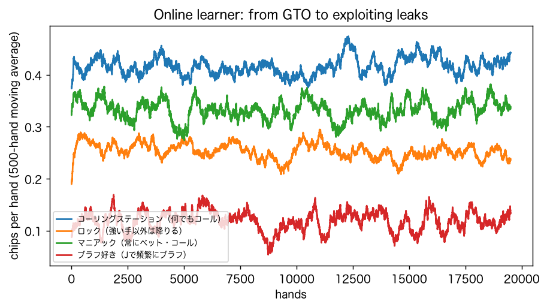

# 研究2　相手が「人」：ポーカーと麻雀

## 1. ポーカーAIを作る：CFRで均衡戦略を学習する

クーン・ポーカー（J・Q・Kの3枚、参加費1チップ、ベット1チップ）は、全ての期待値を数え上げで厳密に計算できる最小のポーカーで、ゲーム理論の標準的な検証台である。Libratus・Pluribusと同じ系統のアルゴリズム（反実仮想後悔最小化、CFR）で均衡戦略を学習させた。

| CFRの反復回数 | 搾取可能性（最善の相手が1手あたり得るチップ） |
|---|---|
| 10 | 0.09114 |
| 30 | 0.05461 |
| 100 | 0.02330 |
| 300 | 0.00890 |
| 1,000 | 0.00650 |
| 3,000 | 0.00429 |
| 10,000 | 0.00149 |
| 20,000 | 0.00161 |

学習後の戦略で先手の期待値は -0.0556 チップ/手（理論値 −1/18 = -0.0556）。先手と後手を交互に務めれば、均衡戦略どうしの対戦の期待値はゼロになる。

## 2. 人間らしい癖を持つ相手との対戦

AIは先手・後手を交互に務める。期待値は数え上げによる厳密値、的中率と標準偏差は各20万手のシミュレーション。「必要な手数」は、その期待値を片側5%・検出力80%で検出するのに要る手数。

| 相手 | AI | 期待値（チップ/手） | 勝った手の割合 | 1手の標準偏差 | 必要な手数 |
|---|---|---|---|---|---|
| コーリングステーション（何でもコール） | 均衡AI（GTO） | +0.1370 | 50.1% | 1.494 | 736 |
| コーリングステーション（何でもコール） | 搾取AI（相手の癖を完全に知る） | +0.4167 | 49.9% | 1.441 | 74 |
| ロック（強い手以外は降りる） | 均衡AI（GTO） | -0.0014 | 54.6% | 1.131 | ∞ |
| ロック（強い手以外は降りる） | 搾取AI（相手の癖を完全に知る） | +0.2500 | 66.7% | 1.091 | 118 |
| マニアック（常にベット・コール） | 均衡AI（GTO） | +0.1136 | 40.9% | 1.596 | 1222 |
| マニアック（常にベット・コール） | 搾取AI（相手の癖を完全に知る） | +0.3333 | 50.0% | 1.700 | 161 |
| ブラフ好き（Jで頻繁にブラフ） | 均衡AI（GTO） | +0.0009 | 46.5% | 1.385 | 13,511,531 |
| ブラフ好き（Jで頻繁にブラフ） | 搾取AI（相手の癖を完全に知る） | +0.1167 | 54.3% | 1.530 | 1063 |
| 均衡AI自身 | 均衡AI（GTO） | +0.0000 | — | — | ∞ |

### 相手の癖をプレイ中に学ぶAI

均衡戦略から始め、相手の行動を情報集合ごとに数えて、100手ごとに推定した相手への最善応答に切り替える。各ハンドの後に相手の手札が見える（AIに有利な仮定）。各相手と2万手、10回の平均。

| 相手 | 均衡AIの期待値 | 学習AI：最初の1,000手 | 学習AI：最後の5,000手 | 完全に知る搾取AI |
|---|---|---|---|---|
| コーリングステーション（何でもコール） | +0.1370 | +0.3871 | +0.4257 | +0.4167 |
| ロック（強い手以外は降りる） | -0.0014 | +0.2373 | +0.2494 | +0.2500 |
| マニアック（常にベット・コール） | +0.1136 | +0.3347 | +0.3388 | +0.3333 |
| ブラフ好き（Jで頻繁にブラフ） | +0.0009 | +0.1092 | +0.1186 | +0.1167 |

## 3. 勝因の分解：AIの利益は相手のどの癖から来るか

相手の12個の情報集合それぞれについて「癖のある戦略」か「均衡戦略」かを選ぶ全4,096通りで、搾取AIの期待値を計算し、シャープレイ値で各情報集合の寄与に分けた。寄与の合計は、搾取AIの期待値と均衡戦略に対する期待値の差に一致する。

**コーリングステーション（何でもコール）**（寄与の合計 +0.4151 チップ/手）：P1: J でベットにコール（相手 1.00／均衡 0.00）+0.1341（32%）、P2: J でベットにコール（相手 1.00／均衡 0.00）+0.1110（27%）、P2: Q でベットにコール（相手 1.00／均衡 0.34）+0.0549（13%）、P1: J で先にベット（ブラフ）（相手 0.00／均衡 0.22）+0.0367（9%）

**ロック（強い手以外は降りる）**（寄与の合計 +0.2484 チップ/手）：P1: Q でベットにコール（相手 0.00／均衡 0.56）+0.0926（37%）、P2: Q でベットにコール（相手 0.00／均衡 0.34）+0.0688（28%）、P2: J でチェック後にベット（ブラフ）（相手 0.00／均衡 0.33）+0.0416（17%）、P1: K で先にベット（相手 1.00／均衡 0.66）+0.0272（11%）

**マニアック（常にベット・コール）**（寄与の合計 +0.3317 チップ/手）：P2: J でベットにコール（相手 1.00／均衡 0.00）+0.0695（21%）、P1: J で先にベット（ブラフ）（相手 1.00／均衡 0.22）+0.0556（17%）、P1: J でベットにコール（相手 1.00／均衡 0.00）+0.0555（17%）、P2: J でチェック後にベット（ブラフ）（相手 1.00／均衡 0.33）+0.0553（17%）

**ブラフ好き（Jで頻繁にブラフ）**（寄与の合計 +0.1151 チップ/手）：P1: J で先にベット（ブラフ）（相手 0.60／均衡 0.22）+0.0491（43%）、P2: J でチェック後にベット（ブラフ）（相手 0.60／均衡 0.33）+0.0329（29%）、P1: K で先にベット（相手 1.00／均衡 0.66）+0.0130（11%）、P2: Q でベットにコール（相手 0.60／均衡 0.34）+0.0108（9%）

どの相手でも、利益の大半は少数の情報集合から来る。強い手でしか参加しない相手からは「Qで降りすぎる」ことが、何でもコールする相手からは「Jでコールする」ことが、AIの利益の源泉になる。AIの勝因は、AI自身の強さではなく、相手の癖の大きさで決まる。

## 4. 場代（レーキ）の影響

勝者がポットから一定割合を場に支払う。均衡AIどうしでは双方がレーキの分だけ負ける。

| レーキ | 均衡AI 対 均衡AI | 搾取AI 対 コーリングステーション | 搾取AI 対 ロック | 搾取AI 対 マニアック | 搾取AI 対 ブラフ好き |
|---|---|---|---|---|---|
| 0.0% | +0.0000 | +0.4167 | +0.2500 | +0.3333 | +0.1167 |
| 2.5% | -0.0362 | +0.3708 | +0.2125 | +0.2833 | +0.0746 |
| 5.0% | -0.0724 | +0.3250 | +0.1750 | +0.2333 | +0.0325 |
| 10.0% | -0.1448 | +0.2333 | +0.1000 | +0.1333 | -0.0517 |

## 5. 麻雀：超人AIでも1回の対局では7割負ける

各打ち手の1局の得点を正規分布とし、平均3人の打ち手（平均0・標準偏差1）と卓を囲む模型に、Suphx論文の順位率（1位と4位）を当てはめた。

| 打ち手 | 得点の平均 | 得点の標準偏差 | 1位 | 2位 | 3位 | 4位 | 安定段位 |
|---|---|---|---|---|---|---|---|
| Suphx（論文値） | — | — | 29.3% | 27.5% | 24.4% | 18.7% | 8.78 |
| Suphx（模型） | +0.202 | 0.904 | 29.4% | 27.7% | 24.3% | 18.6% | 8.88 |
| トップ人間（論文値） | — | — | 28.0% | 26.8% | 24.7% | 20.5% | 7.44 |
| トップ人間（模型） | +0.145 | 0.932 | 28.1% | 26.9% | 24.6% | 20.4% | 7.52 |
| 平均的な打ち手 | 0 | 1 | 25.0% | 25.0% | 25.0% | 25.0% | 5.00 |

同じ局数をSuphxとトップ人間が打ったときの、安定段位の推定のばらつき（各4,000回のシミュレーション）。

| 局数 | Suphxの安定段位の95%範囲 | Suphxの推定値が人間を上回る確率 |
|---|---|---|
| 100 | [4.63, 17.39] | 63.5% |
| 500 | [6.48, 11.73] | 77.4% |
| 1,000 | [7.16, 10.74] | 86.4% |
| 2,000 | [7.54, 10.06] | 92.6% |
| 5,760 | [7.96, 9.55] | 99.2% |
| 10,000 | [8.17, 9.30] | 100.0% |
| 20,000 | [8.33, 9.14] | 100.0% |

Suphxでも1局で1位になれるのは 29.3%、1位を逃す確率は 70.7%。模型では、Suphxの優位は平均の高さ（+0.202）と、得点のばらつきの小ささ（標準偏差 0.904）の両方で表される。ばらつきが小さいほど4位を避けやすく、4位を重く罰する天鳳の段位ルールで有利になる。
