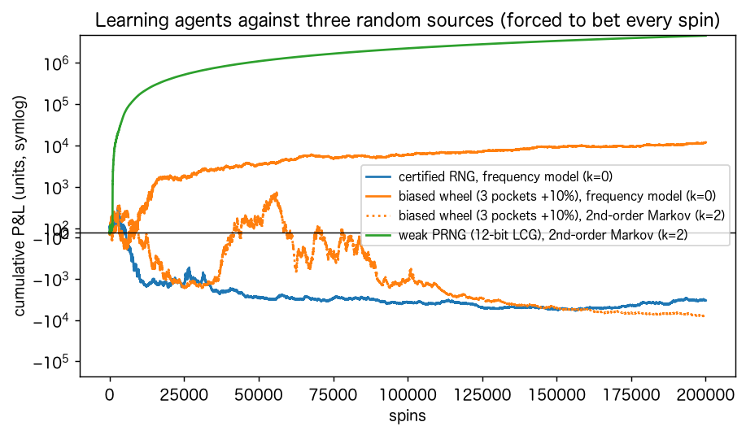
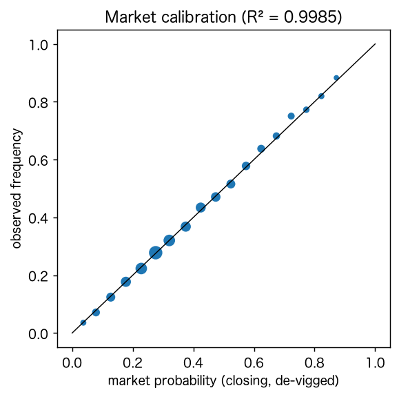
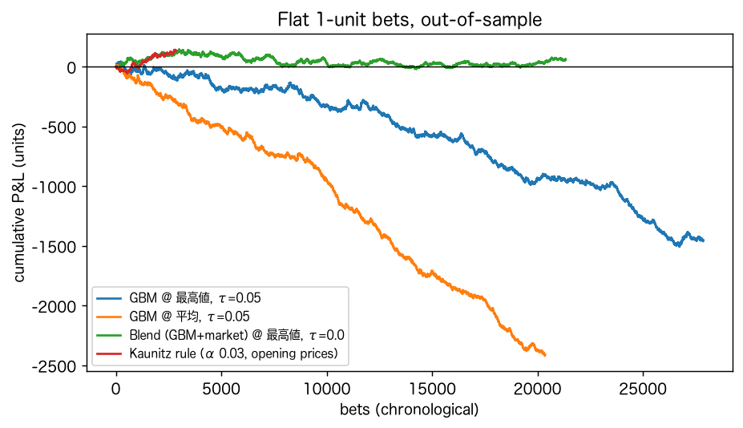
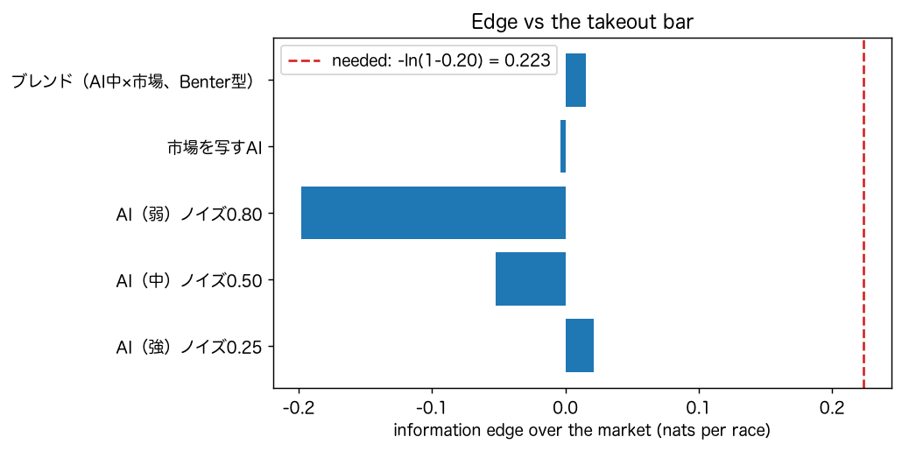
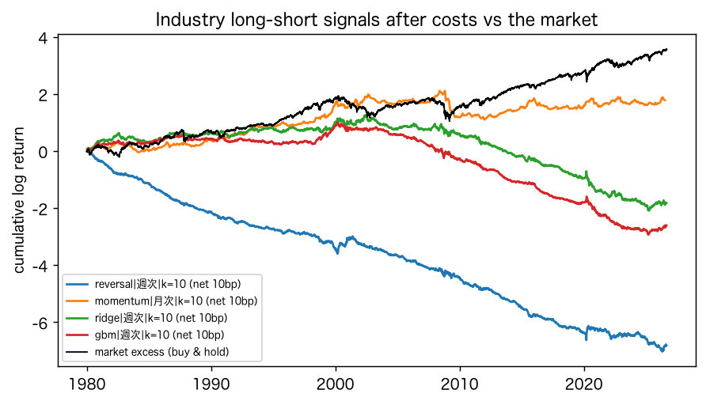

# AIは賭けに勝てるか：プログラムによる検証レポート

AIを使った賭け事と金融トレードについての先行調査（先行研究・公的資料の調査と数値実験。以下「先行調査」）を土台に、「AIは不確実な勝負にどこまで勝てるか」をプログラムで検証した。相手（数学・人・胴元・市場・リスクプレミアム）ごとにAIを実際に戦わせ、勝ち負け、勝率、期待値を測り、勝因と敗因を分解した。

検証には3種類のデータを使った。実データとして欧州サッカー約6万試合のオッズ（football-data.co.uk）と米国株100年分の日次リターン（Kenneth R. French Data Library）。実在のAIモデルとして、Anthropic API 経由の Claude Haiku 5.5。そして、真の確率がわかる模擬（ルーレット、ポーカー、競馬、口座制限）。コードは全てこのリポジトリにあり、`./run_all.sh` で再実行すると、同じ出力がバイト単位で再現される。

> 本レポートは、賭け事や投資・トレードを勧めるものでも、否定するものでもない。数値は仕組みを確かめるための検証結果で、賭けや投資の助言ではない。

---

## 要旨

1. **AIの勝敗は、AIの賢さより「相手」で決まる。** 同じ学習AIが、認証された乱数には理論どおり負け（ROI −2.6%）、欠陥のある乱数源には勝った（偏ったホイールで +6.0%、弱い疑似乱数で +2,265%）。勝因はAIではなく、相手の欠陥だった。
2. **人が相手なら、AIの利益は相手の癖の大きさで決まる。** CFRで学習した均衡AIは、強い手以外は降りる相手からはほとんど稼げなかった（−0.001チップ/手）。癖を突く搾取AIは、同じ相手から +0.25チップ/手を得た。シャープレイ値で分解すると、利益の大半は相手の2〜4個の判断ミスから来ていた。
3. **実データのサッカーでは、機械学習モデルは市場に勝てなかった。** 勾配ブースティングの予測は、市場の終値より log-loss で 0.019 ナッツ悪かった。モデル自身は期待値 +21.6% を見込んだが、平均的な価格で賭けると実際のROIは −11.8%（95%CI −14.1%〜−9.6%、2万回）だった。Benter型にモデルと市場を組み合わせると、モデルの重みはほぼゼロ（シーズンごとに −0.15〜−0.03）と推定された。
4. **プラスの記録を出したのは、予測ではなく価格の比較だった。** 予測モデルを使わず、各社の最高値が平均から大きく離れた結果に賭けるKaunitz型のルールは、ROI +4.7%（t=1.87、2,860回）だった。ただし、最高値は逆選択を受けやすい。最高値が平均の1.2倍以上の結果は、終値の市場確率の85%しか実際に起きていなかった。
5. **勝つ客は、実力を証明する前に制限される。** 研究3の期待値（+3.7%）を持つ客が自分で優位を証明するには約1万回の賭けが要る。胴元の観測（終値との比較）を想定した模擬では、こうした客は全員が制限され、制限までの回数の中央値は38回だった。
6. **競馬（控除率20%）では、どのAIも全頭への比例賭けで負けた。** 成長率の恒等式 W = ln(1−t) + D(p‖r) − D(p‖q) は1レースごとに機械精度で成り立ち、最も強いAIでも情報優位は 0.021 ナッツで、必要な 0.223 ナッツの1割に満たなかった。一方、期待値がプラスの馬だけを選べば勝てる場合があった。単独では負ける中程度のAIも、市場と組み合わせると勝った。ただし、どちらも市場がある程度不正確な場合に限られ、市場の誤差が 0.02 ナッツ以下なら強いAIも負けた。
7. **株式では、AIのシグナルはコストに負け、時代とともに消えた。** 49業種の機械学習シグナル（週次）のシャープレシオは、1980〜1999年にはコスト前で1.4〜1.6あった。しかし片道0.1%のコストで0.5程度に落ち、2013年以降はコスト前でもマイナスになった。全期間・コスト後では、市場の買い持ち（シャープ 0.52）を下回った。
8. **本物のLLMも、市場より不正確だった。** Claude Haiku 5.5 の予測は、市場の終値より log-loss で 0.042 ナッツ悪かった（460試合、95%CI +0.016〜+0.069）。LLMの確率で272回賭けた結果は ROI −17.5% だが、標本が少なく有意ではない（95%CI −38.6%〜+3.5%）。同じ質問への回答は、80%の試合で2回目と食い違った。

全体の結論は先行調査と一致する。**AIは賭けの数学（控除・マージン・コスト）を変えない。AIが勝つのは、相手の欠陥・相手の癖・相手より多い情報があり、その差が控除やコストを上回るときに限られる。** そして勝てる状況ほど、制限・容量・優位の消滅によって、勝ち続けることが難しくなる。


---

## 1. 検証の設計

### 1.1 問い

先行調査は、「勝てる」を3つの水準に分けた。各研究は、そのどれかを測る。

| 水準 | 問い | 主に検証した研究 |
|---|---|---|
| 期待値 | その賭けの期待値・期待成長率はプラスか。何が符号を決めるか | 研究1・2・3・5・6・7 |
| 検証 | その優位を、運と区別できるだけの標本があるか | 研究2・4・6（探索と多重検定） |
| 執行 | その価格で約定し、続けられるか | 研究3（逆選択）・4（制限）・5（容量）・6（コスト・レバレッジ） |

### 1.2 相手とデータ

| 研究 | 相手 | データ | 「AI」 |
|---|---|---|---|
| 1 | 数学（ルーレット・スロット） | 模擬（認証された乱数、偏ったホイール、12ビットの線形合同法） | 出目を数え上げで学習するモデル（文脈なし／2次マルコフ） |
| 2 | 人（ポーカー・麻雀） | クーン・ポーカーの厳密計算、Suphx論文の順位率に当てはめた模型 | CFRの均衡戦略、最善応答、プレイ中に学ぶ搾取AI |
| 3 | 胴元・市場（サッカー） | football-data.co.uk、欧州18リーグ 60,829試合（2017/18〜2026/27） | Elo・得点・シュートを使うロジスティック回帰と勾配ブースティング、Benter型ブレンド |
| 4 | 胴元（口座制限） | 模擬（客の期待値は研究3の実測値） | — |
| 5 | 市場（競馬、控除率20%） | 模擬（真の確率が既知） | 精度の異なる3つのAI、市場を写すAI、ブレンド |
| 6 | 市場（株式） | Kenneth R. French Data Library、米国株日次 1926〜2026年、49業種 | リッジ回帰と勾配ブースティング（毎年学び直すウォークフォワード） |
| 7 | 市場（サッカー） | プレミアリーグ460試合（2022/23〜2026/27） | Claude Haiku 5.5（Anthropic API） |

### 1.3 共通の作法

- **時点の管理：** 実データの研究では、各予測に、その時点より前のデータだけを使った。サッカーの特徴量は同じ日の試合結果も使わない。株式のモデルは、各年を直前10年だけで学習した。訓練データの将来リターンは、予測する年の開始前に確定したものに限っている。
- **比較の基準：** AIの比較相手は「何も知らない予測」ではなく市場とした（サッカーは終値からマージンを除いた確率、株式は買い持ち）。
- **マージンの除去：** オッズからは「べき乗法」でマージンを除いた。単純に合計を1にする乗法では、大穴の確率を過大に見積もり、比較が歪むためである（研究3の1節）。
- **不確実性：** ROIには95%信頼区間をつけた。優位を片側5%・検出力80%で証明するのに必要な標本数も示した。
- **再現性：** 乱数の種は全て固定し、データは SHA-256 つきでキャッシュし、LLMの回答もキャッシュした。全研究を2回実行し、全出力の一致を確認した。

---

## 2. 結果

### 研究1　相手が「数学」：ルーレットとスロット（`outputs/s1_chance.md`）

**同じ学習AIを3つの乱数源に当てた。** 各20万回転、1点賭け（当たれば36倍、期待値 −2.70%）。

| 乱数源 | AI | ROI [95%CI] | 過去の出目が次の出目について持つ情報量 |
|---|---|---|---|
| 認証された乱数 | 2次マルコフ（毎回賭ける） | −2.62% [−5.19%, +0.01%] | ゼロと区別できない（置換検定 p=0.75） |
| 偏ったホイール（3ポケット +10%） | 頻度モデル | **+5.98%** [+3.45%, +8.68%] | 系列の情報はゼロ（偏りは出現率に表れる。最頻ポケット1.10倍） |
| 偏ったホイール | 2次マルコフ | −3.90% [−6.42%, −1.38%] | 同上 |
| 弱い疑似乱数（12ビット線形合同法） | 2次マルコフ | **+2,265%**（的中率 65.7%） | 3.03 ナッツ（p=0.02） |
| 弱い疑似乱数 | 頻度モデル | −39.4% | 同上 |



- **勝因は相手の欠陥にある。** 認証された乱数では、過去の出目が次の出目について持つ情報量がゼロで、どのAIも理論値どおり負けた。勝てたのは、物理的な偏りか実装の欠陥がある乱数源だけだった。
- **欠陥があっても、モデルの構造が合わなければ負ける。** 偏ったホイールは出現率の偏りなので、頻度モデルで捉えられる。2次マルコフモデルでは、データが1,369通りの文脈に分散して捉えられなかった。逆に、弱い疑似乱数は系列の規則なので、頻度モデルでは捉えられない。
- **複雑なモデルほど、存在しないパターンに賭ける。** 「99%の確度で損益分岐を超えるときだけ賭ける」慎重なAIでも、認証された乱数に対して、頻度モデルは316回しか賭けなかった。一方、2次マルコフモデルは16,872回賭けた。1,369の文脈×37ポケットという大量の候補から最大値を選ぶため、偶然の偏りを優位と誤認する（研究6の多重検定と同じ構造）。
- **勝率と期待値は別物である。** マーチンゲール（負けたら倍賭け）は90.8%のセッションで勝った。それでも、賭け金1単位あたりの損益は −2.63% で、均等賭け（−2.72%）と変わらなかった。代わりに、9.2%のセッションで100単位以上を失った。
- **期待値が負なら、最善は賭けないことである。** 期待値−10%のスロット（Lee et al. 2025 と同じ設計）で20回賭ける場合、破産率は固定額で16.1%、負けるたびに倍にすると78.6%だった。ケリー基準の答えは「賭けない」になる。

### 研究2　相手が「人」：ポーカーと麻雀（`outputs/s2_skill.md`）

**クーン・ポーカー**（3枚のカードで行う最小のポーカー）は、全ての期待値を厳密に計算できる。CFRで均衡戦略を学習させると、2万回の反復で搾取可能性は 0.0016 チップ/手まで下がった。先手の期待値は理論値 −1/18 に一致した。

| 相手の癖 | 均衡AI（期待値/手） | 搾取AI（期待値/手） | 搾取AIが勝った手の割合 | 優位の証明に必要な手数 |
|---|---|---|---|---|
| 何でもコールする | +0.137 | +0.417 | 49.9% | 74 |
| 強い手以外は降りる | **−0.001** | +0.250 | 66.7% | 118 |
| 常にベット・コール | +0.114 | +0.333 | 50.0% | 161 |
| Jで頻繁にブラフ | +0.001 | +0.117 | 54.3% | 1,063 |
| 均衡AI自身 | 0 | — | — | ∞ |

- **均衡戦略（GTO）は負けないだけである。** 相手の明らかな悪手（Jでのコールなど）からは稼ぐ。しかし、降りすぎる相手やブラフの多い相手からは、ほとんど稼げなかった。
- **勝因は相手の癖にある。** 相手の12の判断それぞれの寄与をシャープレイ値で分解した。何でもコールする相手からの利益は「Jでベットにコールする」2つの判断だけで59%を占め、降りすぎる相手からの利益は「Qで降りる」2つの判断で65%を占めた。プレイ中に学ぶAIは、最初の1,000手で最善応答の9割以上に達した（各手の後に相手の手札が見えるという、AIに有利な仮定のもと）。
- **場代が小さな優位を消す。** レーキが10%なら、均衡AIどうしは双方が −0.145 チップ/手で負けた。ブラフの多い相手を搾取するAIも、−0.052 チップ/手で負けに転じた。
- **麻雀：超人AIでも1局の7割は1位を逃す。** Suphxの順位率（1位29.3%、4位18.7%）に正規分布の模型を当てはめた。Suphxの優位は、平均の高さ（+0.20）に加え、得点のばらつきの小ささ（標準偏差0.90）で表された。4位を避けることが、天鳳の段位ルールで効く。同じ局数を打ったとき、Suphxの安定段位の推定値がトップ人間を上回る確率は、100局で64%、1,000局で86%、2,000局で93%だった。

### 研究3　相手が「胴元」と「市場」：欧州サッカーの実データ（`outputs/s3_sports.md`）

**市場の予測はほぼ正確である。** 47,468試合について、マージンを除いた終値の確率と実際の頻度を比べた。重み付きR²は0.9985、較正誤差は0.0042だった。始値から終値にかけて、log-loss は 0.0035 ナッツ改善した。本命–大穴バイアスはサッカーにも存在した（平均終値で全結果に賭けたROIは、1.5倍未満で −0.9%、10倍以上で −30.3%）。ただし、どのオッズ帯でもROIはマイナスで、歪みはマージンの内側に収まっていた。



**機械学習モデルは市場に勝てなかった**（2021/22〜2026/27の34,626試合。各シーズンを、それより前のシーズンだけで学習したモデルで予測）。

| 予測 | log-loss | 終値との差 [95%CI] | 的中率 |
|---|---|---|---|
| 基準率 | 1.0750 | +0.083 | 43.4% |
| Eloのみ | 1.0156 | +0.024 | 49.3% |
| ロジスティック回帰（全特徴量） | 1.0083 | +0.017 [+0.015, +0.018] | 49.8% |
| 勾配ブースティング | 1.0105 | +0.019 [+0.017, +0.021] | 49.7% |
| ブレンド（勾配ブースティング＋始値） | 0.9950 | +0.003 | 50.9% |
| 市場（始値） | 0.9950 | +0.003 | 50.9% |
| 市場（終値） | 0.9916 | 0 | 51.3% |

Benter型ブレンド p ∝ p_model^a × p_market^b を過去シーズンで推定すると、モデルの重み a は −0.15〜−0.03 だった。市場の重み b は 1.05〜1.13 で、市場の確率を少し尖らせる（本命–大穴バイアスを補正する）方向だった。このモデルの特徴量は、市場に既に含まれている。

**バリューベットの結果と、期待値の分解**（τ=0.05、1単位の均等賭け）

| モデル・価格 | 賭け数 | モデルが見込んだ期待値 | 価格の比較 | 時機 | マージン | 終値で見た期待値（CLV） | 実際のROI [95%CI] |
|---|---|---|---|---|---|---|---|
| 勾配ブースティング・平均的な1社 | 20,357 | +21.6% | 0 | −0.0% | −8.6% | −7.6% | **−11.8%** [−14.1%, −9.6%] |
| 勾配ブースティング・Bet365 | 21,007 | +22.2% | +1.4% | −0.2% | −8.7% | −6.4% | −10.1% [−12.4%, −7.8%] |
| 勾配ブースティング・全社の最高値 | 27,858 | +24.4% | +6.5% | −0.2% | −8.5% | −1.5% | −5.2% [−7.3%, −3.1%] |
| ブレンド・最高値（τ=0） | 21,336 | +1.7% | — | — | — | −0.3% | +0.3% [−1.3%, +1.9%] |



- **敗因はマージンと、モデルの過信にある。** モデルが選んだ結果は大穴に偏り、大穴ほどマージンが重い（約8.6%）。モデルは +22% の期待値を見込んだが、それは市場との食い違いを「優位」と誤認した結果で、実際には −12% だった。賭けた後にオッズが動いたか（時機）はほぼゼロで、市場はモデルの見方に寄ってこなかった。
- **プラス側の要因は、価格の比較だけだった。** 全社の最高値で賭けると +6.5% 有利になるが、マージンを埋めきれなかった。
- **逆選択がある。** 最高値が平均から大きく離れた結果ほど、実際の頻度が終値の市場確率を下回った（最高値÷平均が1.10〜1.20で0.95倍、1.20以上で0.85倍）。高すぎる価格は、それだけ起きにくい結果（多くは大穴）についている。
- **予測モデルを使わない価格比較のルール**（Kaunitz et al. 2017 型）は、記録上はプラスだった。

| ルール | 賭け数 | ROI [95%CI] | t値 |
|---|---|---|---|
| Kaunitz型（始値、α=0.03） | 2,860 | +4.7% [−0.2%, +9.5%] | 1.87 |
| Kaunitz型（終値、α=0.03） | 8,862 | +4.8% [+1.9%, +7.7%] | 3.29 |
| Pinnacle（低マージンの胴元）の確率を正解とみなし、最高値で賭ける | 27,889 | +0.7% [−1.1%, +2.4%] | 0.76 |

Kaunitzらの論文の数字（締切オッズで+3.5%）と同じ方向だった。ただし、3つの注意が要る。1つ目に、最高値は集計サイトの記録で、取引所や誤った価格を含みうる。2つ目に、α・時点・τを複数試している。3つ目に、勝つ客は制限される（研究4）。

### 研究4　相手が「胴元」：勝つ客の制限（`outputs/s4_house_limits.md`）

5万口座の模擬を行った。客の期待値は研究3の実測値から取った。胴元は、終値との比較（CLV）のt値が2.5を超えるか、利益が40単位を超えた口座を制限する。この規則は、非公開の実務を仮定したものである。

| 客の種類 | 1回の期待値 | 制限された割合 | 制限までの回数（中央値） | 自分で優位を証明するのに必要な回数 | 制限前に自分の利益が有意になった割合（制限がなければ） |
|---|---|---|---|---|---|
| 娯楽の客 | −7.0% | 6.6% | 355 | ∞ | 8.6%（9.5%） |
| AIモデルで賭ける客 | −6.4% | 12.5% | 332 | ∞ | 8.9%（11.2%） |
| 価格を比べる客 | +3.7% | 100% | **38** | **10,218** | 10.5%（49.9%） |
| 鋭い客 | +2.0% | 100% | 112 | 23,185 | 20.5%（41.6%） |

- **胴元は本人より早く実力を見抜く。** 胴元は全賭けの終値との比較を見られるので、本人が利益で優位を証明する（約1万回）よりはるかに早く（数十回で）、勝つ客を特定できる。
- **制限された口座は黒字が多い。** 模擬では、全口座の黒字率は12.8%、制限口座の黒字率は81.3%だった。英国賭博委員会の実データ（全口座25.42%、制限口座46.78%）と同じ方向だが、大きさは仮定の置き方に依存する。
- **残る記録は運のものになりやすい。** 実際には賭けない「予想の記録」でROI +10%以上を示したもののうち、期待値が本当にプラスの客の割合は、50回の記録で8%、200回で19%、1,000回で93%だった。一方、期待値がプラスの客が実資金で200回の記録を作れる割合は4.7%にすぎない。宣伝に出やすい短い記録や紙上の記録は、実力の証拠として弱い。

### 研究5　相手が「市場」：パリミュチュエルの競馬（`outputs/s5_parimutuel.md`）

6万レースを模擬した（8〜16頭、JRAの単勝と同じ控除率20%、10円単位の切り捨て）。真の確率は既知である。

**恒等式と情報優位：** 全頭に予測確率どおりの割合で賭けた場合の成長率は、W = ln(1−t) + D(p‖r) − D(p‖q) と直接計算の差が最大 6.7×10⁻¹⁶ で一致した。

| AI | 情報優位 D(p‖r)−D(p‖q) | 1レースの成長率 W（実現） |
|---|---|---|
| 強い（ノイズ0.25） | +0.021 | −0.202 |
| 中程度（ノイズ0.50） | −0.052 | −0.278 |
| 市場を写すAI | −0.004 | −0.227（≈ ln 0.8） |
| 中程度＋市場（Benter型） | +0.015 | −0.209 |

必要な情報優位は 0.223 ナッツで、最も強いAIでもその1割に満たない。**市場を写すAIは、ちょうど控除率の分だけ負ける。**

**選択的な賭け**（q × オッズ > 1.1 の馬にだけ1単位）

| AI | 賭け数 | 的中率 | AIが見込んだ期待値 | 真の期待値 | 実際のROI [95%CI] | 控除 | 情報優位 ln(p/r) |
|---|---|---|---|---|---|---|---|
| 強い | 96,219 | 12.2% | +36.4% | +11.8% | +10.6% [+7.6%, +13.5%] | −22.3% | +31.5% |
| 中程度 | 135,413 | 10.5% | +55.1% | −3.7% | −7.0% [−9.3%, −4.7%] | −22.3% | +14.8% |
| 中程度＋市場 | 6,846 | 14.5% | +16.3% | +20.8% | +21.7% [+12.2%, +31.2%] | −22.3% | +38.3% |

- **勝因は、控除率を超える情報優位を持つ馬だけを選ぶことである。** 全体の優位は小さくても、特定の馬では ln(p/r) が 0.223 を超える。
- **市場と組み合わせると、単独では負けるAIが勝てる**（Benter 1994 の再現）。AIの見込みは真の期待値より大きく（+55% と −4%）、誤差が有利に出た馬を選んでしまう。市場と組み合わせると、この過信が抑えられた。
- **ただし、相手の市場の精度しだいで結論が変わる。** 既定の設定は、市場の誤差 D(p‖r) が0.046ナッツの比較的不正確な市場である。誤差が0.013ナッツ（ノイズ0.10）の正確な市場では、同じ強いAIの真の期待値は −17.0% だった。研究3の実データのように市場が正確なら、この優位は成り立たない。
- **容量に上限がある。** 単勝の総票数を3,000万円とし、自分の賭けでオッズが下がることを考慮して賭け金を最適化した。それでも、期待利益は1レースあたり総票数の0.23%だった。Benterが自身の上限として見積もった「売上の0.25〜0.5%」と同じ水準である。
- **ケリー基準で賭けると：** 強いAIでもフルケリーでは資金が減った（−0.0027/レース）。1/2ケリーと1/4ケリーでは増えた（+0.0028、+0.0026）。AIは自分の優位を過大に見積もるため、ケリーの2倍近くを賭ける状態になる。



### 研究6　金融市場：米国株100年の実データ（`outputs/s6_trading.md`）

**リスクプレミアム：** 1926〜2026年の年率超過リターンは +7.84%、変動率は17.1%、シャープレシオは0.46だった。株式が現金を上回った割合は、保有期間で大きく変わる。

| 保有期間 | 1日 | 1か月 | 1年 | 10年 | 20年 |
|---|---|---|---|---|---|
| 株式が現金を上回った割合 | 54.0% | 61.0% | 70.9% | 86.4% | 100% |

**実力ゼロのデイトレーダー**（1990〜2026年、毎日無作為に買いか売り、往復0.1%）：資産の中央値は現金の0.0001倍だった。買い持ち（17.3倍）を上回った人は0%。往復0.02%に下げても、全期間で現金を上回ったのは1.1%だった（同じ0.02%の条件で、1年目だけなら32.8%が現金を上回る）。

**レバレッジ**（毎日L倍に持ち直す、借入の上乗せ年0.5%）：実績の成長率は理論式 L(μ−k) − L²σ²/2 とほぼ一致した。2〜3倍で最大（+8.8%）、5倍でマイナス（−1.5%）になった。6倍以上は、1日で資金を失った（6倍は1987年10月19日の −17.4%、10倍と25倍は1929年10月）。生き残れる上限は 1/0.174 ≈ 5.7倍だった。

**AIの売買シグナル**（49業種、上位10業種を買い下位10業種を売る、1980〜2026年）

| シグナル | コスト前シャープ | 片道5bp | 片道10bp | 片道20bp | IC（t値） |
|---|---|---|---|---|---|
| リッジ回帰・週次 | 0.48 | 0.14 | −0.19 | −0.85 | +0.031（5.8） |
| 勾配ブースティング・週次 | 0.49 | 0.04 | −0.42 | −1.33 | +0.024（5.6） |
| モメンタム（12−1か月）・月次 | 0.39 | 0.36 | 0.32 | 0.26 | +0.057（5.0） |
| 短期リバーサル・週次 | 0.13 | −0.41 | −0.94 | −2.02 | −0.005（−1.2） |
| 参考：市場の買い持ち | 0.52 | — | — | — | — |

| 時代 | 1980〜1999 | 2000〜2012 | 2013〜2026 |
|---|---|---|---|
| リッジ回帰・週次（コスト前 → 片道10bp後） | 1.37 → 0.50 | 0.29 → −0.26 | −0.18 → −0.82 |
| 勾配ブースティング・週次 | 1.58 → 0.51 | −0.04 → −0.80 | −0.15 → −1.09 |



- **予測可能性は実在したが、小さく、時代とともに消えた。** 機械学習のICは統計的に有意だった（t値5〜6）。しかし、週次で売買する回転率（1回あたり約2）がコストを膨らませ、片道10bpでシャープはマイナスになった。1980〜90年代にあった優位は、2000年以降、コスト前でも消えた。
- **探索の罠がある。** 16通りから1980〜1999年のコスト後成績で最良（モメンタム・月次）を選ぶと、標本内シャープは0.68だった。2000〜2026年には0.13に下がった。全期間の成績は、1つだけ試したなら有意に見える（PSR 98.2%）。しかし、16通りから選んだことを考慮した Deflated Sharpe では、運による最良値の期待値を上回る確率が 0.0% だった（試行間のシャープの分散が大きいため、この補正は厳しめに出る）。

### 研究7　本物のLLM（Claude Haiku 5.5）に賭けさせる（`outputs/s7_llm.md`）

プレミアリーグの460試合を、10〜20試合ずつ Claude Haiku 5.5 に渡した。API呼び出しは計161回で、入力12.1万トークン、出力6.9万トークンだった。

**結果を覚えているか：** スコアを答えた割合は、2022/23で31%、2023/24で18%、2024/25で5%、2025/26以降は0%だった。モデル自身が答えた学習データの終わり（2025年初め頃）と整合する。ただし、答えた試合のうちスコアが正しいのは16〜40%、勝敗が正しいのは45〜67%で、記憶は不正確だった。

| シーズン | LLM（オッズなし） | LLM（オッズあり） | 市場（始値） | 市場（終値） | LLM（オッズなし）− 終値 [95%CI] |
|---|---|---|---|---|---|
| 2022/23 | 0.989 | 0.970 | 0.953 | 0.954 | +0.035 [−0.026, +0.095] |
| 2023/24 | 0.930 | 0.885 | 0.883 | 0.869 | +0.061 [−0.001, +0.124] |
| 2024/25 | 0.947 | 0.854 | 0.854 | 0.859 | +0.088 [+0.036, +0.140] |
| 2025/26 | 1.053 | 1.061 | 1.050 | 1.034 | +0.019 [−0.028, +0.066] |
| 2026/27 | 1.042 | 1.049 | 1.050 | 1.056 | −0.014 [−0.084, +0.057] |
| 全体（460試合） | 0.988 | 0.956 | 0.950 | 0.946 | **+0.042** [+0.016, +0.069] |

- **LLMは市場より不正確だった。** オッズを見せても、市場の始値とほぼ同じか少し悪い程度で、上回らなかった。
- **今回の条件では、記憶による先読みの利益は見られなかった。** 学習データの期間内のシーズンでも、LLMは市場に勝っていない。勝敗を正しく思い出せた29試合でも、LLMが実際の結果につけた確率（平均0.48）は市場（0.57）より低かった。この結果は「結果を使わないで」という指示と、記憶の弱さの両方による可能性がある。先行研究（Profit Mirage）が報告した先読みの影響を否定するものではない。
- **賭けの結果：** オッズを見せた予測で、LLMの確率 × 最高値 > 1.05 の結果に272回賭けた。ROIは −17.5% [−38.6%, +3.5%] で、終値で見た期待値（CLV）は +0.06% だった。数百回では、ROIで優位の有無を判定できない。
- **再現性がない。** 同じプロンプトを2回送ると、確率が完全に一致した試合は19.8%で、最も高い確率の結果が入れ替わった試合が8.9%あった。

---

## 3. 横断分析：勝因と敗因

| 相手 | AIが勝った条件（勝因） | AIが負けた理由（敗因） |
|---|---|---|
| 数学 | 乱数源の欠陥（物理・実装）と、それに合ったモデル構造 | 情報量ゼロ。控除がそのまま期待値になる。複雑なモデルほど偶然に賭ける |
| 人 | 相手の癖。利益は少数の判断ミスに集中する | 相手が均衡に近いと稼げない。場代、分散、規約 |
| 胴元 | 各社の価格のばらつき（価格の比較） | マージン、逆選択、勝つ客の制限（記録の打ち切り） |
| 市場（競馬・サッカー） | 控除を超える情報優位を持つ対象だけを選ぶこと。市場との組み合わせ | 市場の精度が高い。AIの過信（見込んだ期待値の水増し）。容量の上限 |
| 市場（株式） | 長期保有でのリスクプレミアム（AIは不要）。かつては短期の予測可能性もあった | 回転率×コスト、優位の減衰、探索による過学習、レバレッジと急落 |
| LLM | — | 市場より不正確。オッズを見せても市場を超えない。同じ質問への答えが変わる |

勝因に共通するのは、**AIの性能そのものではなく、相手との関係**である。相手の欠陥、相手の癖、相手（市場）の不正確さ、市場どうしの価格差があり、その差が控除やコストを上回るときにだけ、AIは勝った。敗因に共通するのは、**期待値を決める項がAIの外側にあること**である。控除、マージン、コスト、制限、容量がそれに当たる。

検証の水準ごとに見ると、次のとおりである。

- **期待値の水準では、AIが勝てる状況は確かにある。** 欠陥のある乱数、癖のある相手、不正確な市場、価格のばらつきがその例である。
- **検証の水準では、多くの場合、運と区別できない。** 証明には数千〜数万回の賭けが要る。複数の戦略を試せば、偶然の勝者が現れる。
- **執行の水準では、さらに制約がある。** 勝つ客の制限、自分の賭けによるオッズの低下、記録上の最高値で約定できないこと、取引コストが、紙上の優位を削る。

---

## 4. 先行調査の主張との照合

| 先行調査の主張 | 検証結果 | 判定 |
|---|---|---|
| W = ln(1−t) + D(p‖r) − D(p‖b)。市場並みなら控除率の分だけ負ける | 恒等式は機械精度で一致。市場を写すAIの W = −0.227 ≈ ln 0.8（研究5） | 再現 |
| JRA単勝で市場に勝つには 0.223 ナッツの情報優位が要る | 最強のAIでも 0.021 ナッツ。全頭比例賭けでは全AIが負け（研究5） | 再現 |
| 期待値がプラスに見える対象だけを選ぶと、推定は系統的に過大になる | 競馬：見込み +36%、真の値 +12%。サッカー：見込み +22%、実際 −12%（研究3・5） | 再現 |
| Benterはモデルと群衆を組み合わせ、利益の上限は売上の0.25〜0.5% | 組み合わせで負けから勝ちへ。容量は総票数の0.23%（研究5）。実データではモデルの重みはほぼゼロ（研究3） | 模擬では再現、実データでは組み合わせる価値なし |
| オッズの確率は実際の勝率とよく一致する（R²＝0.999） | R²＝0.9985（4.7万試合、研究3） | 再現 |
| 本命–大穴バイアスは実在するが、控除の内側に収まる | サッカーで −0.9%〜−30.3%、全帯でマイナス（研究3） | 再現 |
| Kaunitz型の価格比較は収益を出す（3.5%） | +4.7〜4.8%（t=1.9〜3.3）。ただし最高値は逆選択を受ける（研究3） | 方向は再現、執行可能性は未検証 |
| 勝つ客は制限され、記録が打ち切られる | 模擬で、期待値プラスの客は全員が数十回で制限（研究4） | 機構は再現（規則は仮定） |
| 証明に必要な標本 n ≈ 6.18(o−1)/e² | +3.7%の客で約1万回、+2%で約2.3万回（研究4） | 整合 |
| 勝率と期待値は別物（較正・賭け方） | マーチンゲールは勝率91%で期待値は同じ（研究1）。GTO対ロックは勝率55%で期待値ゼロ（研究2） | 再現 |
| 人との技能ゲームではAIが強いが、分散が大きい | 搾取AIは大きく稼ぐ。Suphxでも、人間との差が9割の確率で見えるまで約2,000局（研究2） | 再現 |
| リスクプレミアムは長期ではプラス、短期ではほとんど見えない | 20年では100%、1日では54%（研究6） | 再現 |
| デイトレードは高い控除率の賭けと同じ | 実力ゼロのトレーダーで、買い持ちを上回ったのは0%（研究6） | 再現 |
| L = 2L* で成長ゼロ。ギャップで L < 1/\|J\| | 実データで2〜3倍が最適、6倍以上は1日で破綻（研究6） | 再現 |
| 機械学習の予測可能性は小さく、コストと公表後の減衰で消える | IC 0.02〜0.03、コスト後マイナス。2000年以降は消滅（研究6） | 再現 |
| 探索を増やすと偶然の勝者が増える | 標本内最良のシャープ 0.68 → 標本外 0.13（研究6）。複雑なモデルの偽の賭け（研究1） | 再現 |
| LLMは予測で市場に近づいたが、収益では届かない | 市場より不正確（+0.042 ナッツ）、ROIは有意でない（研究7） | 再現（1モデル・460試合） |
| LLMは知識カットオフ前の期間で過大評価される（先読み） | 記憶は部分的にあったが、予測の利益にはつながらなかった（研究7） | この条件では確認できず |
| LLMの出力は同じ条件でも再現しない | 完全一致は19.8%、最有力の結果が入れ替わったのは8.9%（研究7） | 再現 |
| 賭け金の裁量が破産を招く | 損失を取り返す賭け方で、破産率が16% → 79%（研究1。LLMではなく規則で模擬） | 機構は再現 |

---

## 5. 限界

- **模擬の仮定：** 研究1・2・4・5の数値は、設定に依存する。研究5では、AIと群衆の誤差を独立とした（現実より AI に有利）。研究4の制限規則と客の構成は、非公開の実務を仮定したものである。クーン・ポーカーは最小のポーカーで、実際のポーカーは、優位に対する分散がはるかに大きい。
- **サッカーのデータ：** 始値はデータ提供元が記録した時点の価格で、実際に約定できたとは限らない。「最高値」は取引所（手数料前）や誤った価格を含みうる。モデルの特徴量は結果とシュートだけで、先発・負傷・期待得点（xG）などは使っていない。より情報の多いモデルなら結果は変わりうるが、比較相手の市場の終値は、それらの情報を既に織り込んでいる。
- **株式のデータ：** 業種ポートフォリオはそのままでは売買できない（実際には業種ETFなどを使う）。コストは片道5〜20bpと仮定した。空売りのコストと税は含めていない。
- **LLM：** 1つのモデル（Claude Haiku 5.5）、460試合、既定のサンプリング設定で検証した。このSDKの版はtemperatureの指定を受け付けなかった。他のモデル、プロンプト、検索ツールつきのエージェントには一般化できない。知識カットオフはモデルの自己申告と記憶テストからの推定である。
- **日本の競馬の実データは使っていない。** JRAのデータは利用条件の確認が必要なため、模擬で代えた。

---

## 6. 再現方法

```bash
uv sync
./run_all.sh
```

- 初回は公開データをダウンロードする（数分）。2回目以降は約1分で終わる。取得元・SHA-256・取得日時は `data/MANIFEST.json` にある。
- データ提供元は随時更新される（サッカーは今シーズンの試合が増え、株式は毎月更新される）。読み込み時に、公開した結果の最終日（サッカー 2026-10-14、株式 2026-08-31）でデータを切るので、過去の行が修正されない限り同じ結果になる。取得したファイルが記録と異なるときは注意を表示する。
- 研究7は、`data/llm_cache/` にある回答を再採点する。キャッシュを消すと、Anthropic API に再び問い合わせる（`ANTHROPIC_API_KEY` が必要）。
- 各研究の詳細な結果は `outputs/s*_*.md`、数値は `outputs/s*_*.json`、図は `outputs/figures/` にある。
- 2回の全実行で、全ての Markdown と JSON がバイト単位で一致することを確認した。
